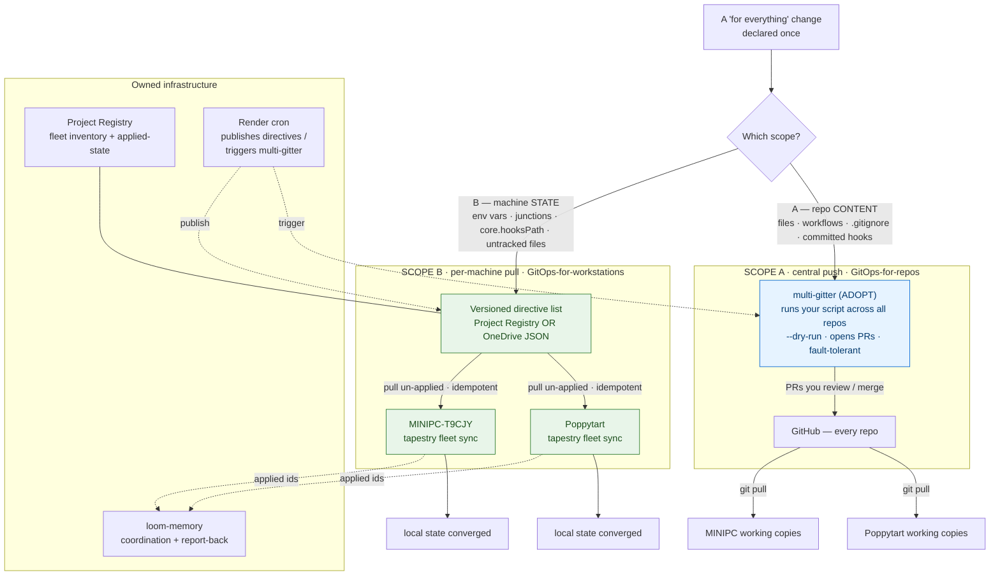

# Fleet change propagation — updating all repos + both machines at once

**Date:** 2026-11-07
**Status:** Design / research report (pre-decision)
**Classification:** dev-tooling (design doc). The mechanism it describes spans `tapestry-cli`, Render cron, the Project Registry, the OneDrive synced folder, and loom-memory.

## The problem

Some changes are "for everything, not one project" — add a git hook + CI check to every repo, add a `.gitignore` rule everywhere, set a machine env var, create a per-repo junction, bump a shared convention. Today these are applied by hand, per repo, per machine (we hand-ran exactly this twice on 2026-11-07: the OneDrive activation loop and the ADR-0010 guard rollout across 8 repos). The need: **declare such a change once and have it reach all repos on both machines**, idempotently and safely.

## The boundary: two scopes, two conventions

The need splits cleanly in two, and the industry solves each differently. **Do not force one tool to do both.** The unifying idea is **desired-state reconciliation** — converge each target to a declared state.

| | **Scope A — repo CONTENT** | **Scope B — machine STATE** |
|---|---|---|
| Examples | files, CI workflows, `.gitignore`, committed hooks | env vars, junctions/symlinks, `git config core.hooksPath`, untracked local files |
| Lives in | git / GitHub (committable) | only on each machine's disk (git can't carry it) |
| Who can apply it | a central job against GitHub | only each machine itself |
| Direction | **central push** → GitHub → machines pull via `git pull` | **per-machine pull** of a central directive list |
| Convention | "mass change / batch changes / multi-repo management" | pull-based desired-state reconciliation (`ansible-pull` / chezmoi / ArgoCD control loop) |
| Decision | **ADOPT** a tool (`multi-gitter`) | **BUILD** a thin `tapestry fleet sync` |

The boundary line is the git/GitHub edge: if the change is a file that can be committed, it's A and can be done centrally; if it's local machine state, it's B and must be pulled per machine.

## Diagram

## Direction + what updates "at once"

- **Scope A is central and fans out to all repos at once.** One `multi-gitter` run (from one machine or Render cron, with just a GitHub token) clones every repo, applies your script, and opens a PR per repo. You review/merge; both machines then receive it on their next `git pull`. "At once" = one command → N repos.
- **Scope B fans out to all machines, but each machine pulls.** A change is *declared once* (a versioned directive in the registry or the OneDrive JSON). Each machine's `tapestry fleet sync` (on a 15–30 min Scheduled Task **and** on demand) pulls the directives it hasn't applied and applies them idempotently. "At once" = declare once → every machine converges on its next sync. Render cron can only *publish* directives — it cannot reach into a laptop's env vars/junctions; only the local agent can.

## Options to make it happen

**Scope A (repo content):**
- **multi-gitter (recommended)** — single Go binary, run-any-script, PR lifecycle, `--dry-run`, fault-tolerant. Lowest ceremony.
- **mass-driver** — Python; changes as versioned plugins + read-only scanners. More ceremony; good if changes should be packaged/reused.
- **octoherd** — GitHub-API level (repo settings, labels, branch protection), not bulk file edits.
- **Sourcegraph Batch Changes** — most mature UX/tracking, but needs a Sourcegraph instance (heavy for solo).
- Workspace managers (`meta`/`mani`/`gita`/`mr`/`gitopolis`, `git for-each-repo`) — fan-out a command, no PR lifecycle.

**Scope B (machine state):**
- **Thin `tapestry fleet sync` (recommended)** — pull-reconciler on the infra already owned (registry + CLI + OneDrive + memory). Stdlib Python, cross-platform.
- **chezmoi** — mature cross-platform pull tool; good as the *file-dropping* backend for the plain-config slice of B, with `tapestry fleet sync` handling the imperative bits (junctions, env vars, `core.hooksPath`).
- **ansible-pull** — the canonical pull pattern, but Windows-as-target is awkward; borrow the pattern, not the tool.
- **Ansible push / Salt / Chef / Puppet** — rejected: need a controller + SSH/WinRM into each box; too heavy for two personal machines.

## Safety patterns (both scopes)

- Idempotent **check-before-apply** (converge, don't blindly run).
- **`--dry-run` / preview** before any fan-out — otherwise one mistake becomes N.
- **Applied-version tracking**: each directive has a stable id; a machine records its applied set and runs only new ids.
- **Per-target result reporting**: record success/failure per repo and per machine (→ "landed on both machines?" view).
- **Drift handling**: per directive, choose enforce (re-assert) vs report.
- **Single-flight lock** (`flock`/mutex), absolute paths, per-item try/except so one failure doesn't abort the rest.

## What must be covered (cross-machine / all-repo inventory)

From loom-memory `cross-machine-all-repo-concern-inventory-2026-11-07`:

- **A. Per-machine local state** (git doesn't carry it): env vars (`TAPESTRY_SHARED_DIR`, `TAPESTRY_MEMORY_API_KEY`, `OTEL_*`), `.mcp.json`, `.claude/settings.json` + installed plugins, `tapestry-cli` pip version, `core.hooksPath`, `.shared` junctions. → **Scope B**.
- **B. All-repo conventions** (committed, identical): the private-files guard, `.gitignore` rules, CLAUDE.md, `docs/`+`skills/` scaffolding. → **Scope A**.
- **C. Already centralized** (consume only): loom-memory, Project Registry, telemetry, deployed services.
- **D. Coordination/drift**: git divergence (hit 3/8 repos this session), plugin-version drift, loom-memory handshakes, the `device-coordination` skill.

(Note the label flip: inventory category A = machine state = this doc's Scope B; inventory category B = repo content = this doc's Scope A.)

## Recommendation

1. **Scope A → adopt `multi-gitter`.** Codify the guard-style rollout we hand-ran as a reusable campaign script; optionally let Render cron trigger recurring runs.
2. **Scope B → build `tapestry fleet sync`**, a pull-reconciler: versioned directive list (registry or OneDrive JSON) → each machine applies un-applied directives idempotently → reports applied ids to loom-memory. Scheduled Task + on-demand; Render cron publishes directives only.
3. **Next step:** turn this into an ADR fixing the A/B convention (like ADR 0010), then implement B first (it's the painful half and is fully ours to build) and wire A second.

---

## Full research report (verbatim)

*Produced by a research agent, 2026-11-07. Secondary sources (blogs/ADRs) are flagged; confirm tool version specifics against upstream READMEs before implementing.*

### Summary
The question splits cleanly into two problems that the industry solves with **two different conventions**, and almost nobody uses one tool for both:

- **(A) Repo-content changes** (files, workflows, `.gitignore`, hooks that live in `.git/hooks` or a committed dir) are handled by **multi-repo "mass change" / "batch change" tooling** that runs a script across N repos and opens PRs (or direct-pushes) against GitHub centrally. This is a solved space — adopt a tool, don't build.
- **(B) Local machine state** (env vars, junctions/symlinks, `git config --global core.hooksPath`, untracked local files) cannot be done by a cloud/CI job because it only exists on each box. The convention here is **pull-based desired-state reconciliation**: each machine runs an agent (on cron / timer / on-demand) that fetches a central declared state and applies anything not yet applied, idempotently. This is exactly `ansible-pull`, and exactly what dotfile managers (chezmoi) do. For your specific setup (Render-cron + `tapestry` CLI + registry + synced folder + memory, no SSH controller) the convention says **build a thin `tapestry fleet sync` pull-reconciler** rather than adopt a heavy config-management suite.

### 1. Is there a standard category + name?
Yes, several overlapping ones, and the precise term depends on scope:
- Scope A has a real name: **"mass change" / "batch changes" / "multi-repo management"**. Sourcegraph's product literally calls it **Batch Changes**; the pattern of one scripted change fanned across many repos opening PRs is the recognized shape. "Repo fleet" and "campaign" are informal/marketing variants; they are not the dominant technical term.
- Scope B has a different, older name: **configuration management** and, in modern Git-driven form, **GitOps / desired-state reconciliation**. Applied to dev machines specifically there is no formal standard — it's community practice built on `ansible-pull` and dotfile managers.
- The umbrella idea "declare desired state centrally, converge each target to it" is **desired-state reconciliation** (a.k.a. the reconcile loop / control loop). That is the single concept that unifies A and B.

### 2. Scope A — repo-content-across-many-repos (tool comparison)

| Tool | Lang | Model | PR vs direct | Cross-platform | Fit for "run a script across all my repos" |
|---|---|---|---|---|---|
| **multi-gitter** (lindell/multi-gitter) | Go (single binary) | run a script/binary per repo, it commits the diff | **PR-based** (also merge/close/status subcommands); `--manual-commit` option | Yes (Go binary, Win/mac/Linux) | **Best low-ceremony fit.** Your change = any script that edits files; it clones, runs, commits, opens PRs. Continues past failing repos; dry-run supported. Actively released (v0.63.x, 2026). |
| **mass-driver** (Overkillguy/mass-driver) | Python 3.11 | define a `PatchDriver` class + TOML migration; has read-only **scanners** to survey first | **PR-based** (forge section; can push-before-PR) | Yes (Python) | Strong fit, heavier ceremony (write a driver class + TOML). Scanners are a nice "what needs changing" dry survey. Good if you want changes as versioned, packaged Python plugins. |
| **octoherd** (@octoherd/cli) | Node/JS | async `script(octokit, repo, opts)` using the GitHub API | Works via **GitHub API** — good for repo *settings/metadata* (branch protection, labels, API-level changes), less for bulk file edits | Yes (npx) | Fit for API-level fleet changes, not primarily file-content. Confirms mutations unless `--octoherd-bypass-confirms`. `owner/*` wildcard targeting. |
| **Sourcegraph Batch Changes** | server + `src` CLI | batch spec (YAML) → steps per matched repo | **PR-based**, single dashboard to track/merge | Yes | Most mature UX + tracking, but needs a Sourcegraph instance — heavy for a solo dev. Good idempotency model (see §5). |
| **ghorg** (gabrie30/ghorg) | Go | **clone/backup** every repo in an org/user to one dir | n/a (not a change tool) | Yes | Useful *companion*: get a local mirror of all repos, then run a loop/script over them. Re-run overwrites local changes by default. |
| **meta / mani / gita / myrepos(mr) / gitopolis / `git for-each-repo`** | JS / Go / Py / Perl / Rust / git | run the *same command* across a registered set of repos | direct (whatever your command does) | Yes | "Fan-out a command" workspace managers, not PR orchestrators. Fine for `git pull`/status/ad-hoc, no built-in PR lifecycle. Git now ships `git for-each-repo` built in. |
| **Renovate / Dependabot** | hosted/self-host bots | dependency bumps only, per-repo config | PR-based | Yes | Not general-purpose; only dependency/version bumps. Rolling *their own config* across repos itself needs an orchestrator. |

**PR-based vs direct-push:** multi-gitter, mass-driver, Sourcegraph, Renovate/Dependabot default to **PRs** (reviewable, reversible). The workspace managers (meta/mani/gita/mr/gitopolis) do **direct** whatever-you-run. For a solo dev, PR-based is still the safer convention (you get a diff to eyeball and a revert point), but PRs you then have to merge — multi-gitter can auto-merge.

**Pick for A:** **multi-gitter** — single Go binary (trivial on both Windows machines), lowest ceremony, run-any-script model, full PR lifecycle, dry-run, fault-tolerant. mass-driver is the runner-up if you want changes as reusable versioned plugins.

### 3. Scope B — machine state across machines (tool comparison)

| Tool | Model | Push/Pull | Cross-platform (Windows) | Fit |
|---|---|---|---|---|
| **ansible-pull** | node pulls a playbook repo, applies locally | **Pull** | Weak on Windows as a *target* (Ansible control node assumes POSIX; Windows control is unsupported) | The *canonical pull pattern* — but Windows-as-target is awkward. Borrow the pattern, not the tool. |
| **Ansible (normal)** | central controller SSHes out and pushes | Push | Needs a controller + SSH/WinRM to each box | Wrong shape: you explicitly have no controller and no always-on SSH. |
| **Salt / Chef / Puppet** | agent + master (or masterless) | Both; classically pull-agent | Heavy; Windows supported but enterprise-weight | Overkill for two personal machines. |
| **chezmoi** | one repo of declared dotfiles/state; `chezmoi apply` converges the machine; templating for per-machine diffs; `chezmoi init --apply` one-line bootstrap | **Pull** | **Yes — explicit Windows + mac + Linux support** | **Best off-the-shelf fit for B** if your machine state can be expressed as files/templates + run-on-change scripts. Handles per-machine differences and secrets. |
| **yadm** | git wrapper, files in real locations, `alternates` for per-host | Pull | Yes (git-based) | Lighter than chezmoi; weaker per-machine logic. |
| **GNU Stow** | symlink a repo into `$HOME` | Pull (manual) | Poor on Windows (symlink/junction friction) | Too primitive; no templating, no scripts. |

**Convention for two personal Windows dev machines with no controller: PULL.** Every source agrees push requires a controller holding credentials to each node and reachable network/SSH — which you don't have and don't want. Pull lets each machine converge itself whenever it's online, tolerates dynamic IPs and offline periods, and needs no inbound access. Dotfile managers are all pull by design.

### 4. Push vs pull for multi-machine with cron + registry — the finding
**Your instinct is correct and it is a named, recognized pattern.** A per-machine `tapestry fleet sync` that reads a central desired-state/pending-directives list and applies the un-applied ones idempotently is **pull-based desired-state reconciliation** — the same control-loop ArgoCD uses for clusters and `ansible-pull` uses for hosts, scaled down to two workstations.

Pros of pull (for your case):
- No controller, no inbound SSH, no always-on dev box needed — matches your constraints exactly.
- Tolerates machines being off/offline; each converges on next run.
- Credentials stay local (each machine authenticates outbound to GitHub/registry); nothing external holds keys to your boxes.
- Render-cron can't touch machine state anyway — only a local agent can — so pull is the *only* option for scope B. (Render-cron's right job is firing scope-A batch runs and/or publishing new directives, not reaching your laptops.)

Cons of pull:
- Latency/non-determinism: a change lands "eventually," when each machine next syncs — not instantly. (Mitigate with an on-demand `tapestry fleet sync` plus a short cron, e.g. 15–30 min, and `flock`/mutex to avoid overlapping runs.)
- No central "did it land everywhere yet?" unless each machine reports results back. Fix by writing per-machine applied-state back to the registry or memory service.
- The central repo/registry becomes a single point of truth (and failure); machines keep last-good state if it's unreachable.

### 5. Idempotency + safety (how mature tools make fleet changes safe)
Patterns to copy:
- **Idempotent apply / converge, not imperative run:** re-applying the same declared state is a no-op (Sourcegraph: re-applying an unchanged spec yields the same result; chezmoi/ansible converge to declared state). Check-before-change each directive.
- **Dry-run / preview first:** multi-gitter dry-run, `src batch preview`, mass-driver read-only **scanners**, octoherd confirm-prompts. Always preview a fleet change before it fans out.
- **Applied-version tracking (the key to "don't re-apply"):** give each directive a stable id/version; each machine records the last-applied id (locally and/or back to the registry/memory). The sync loop applies only ids greater than / not in its applied set. Sourcegraph's CLI keeps a local step-cache keyed on repo+steps; ansible-pull records the repo HEAD it converged to.
- **Per-target result reporting:** record success/failure per repo and per machine. Write a per-machine/per-directive result row to the registry or memory so you can see "applied on machine-1, pending on machine-2."
- **Drift handling:** reconcilers re-assert desired state on every run, so manual local drift is corrected (or at least flagged) next cycle. Decide per-directive whether to **enforce** (re-assert) or only **report** drift.
- **Concurrency + fault isolation:** single-flight lock (`flock -n` / a mutex file — your synced folder or memory can hold a lock), absolute paths in cron, log to a file; one repo/directive failing must not abort the rest.

### 6. Recommendation
**A and B need different answers — do not force one tool to do both.**

**Scope A (committable repo-content): ADOPT `multi-gitter`.** Single Go binary on both machines (or run it from Render-cron / one machine against GitHub centrally — it only needs a token). Express each "for everything" repo change as a small script; multi-gitter fans it out and opens PRs you review/merge. Use its dry-run before every campaign. (mass-driver only if you'd rather package changes as versioned Python plugins.) Because it's committed, both machines pick it up on next `git pull`.

**Scope B (local machine state): BUILD a thin `tapestry fleet sync` pull-reconciler** on top of what you already have. Minimal design:
1. **Desired state = an ordered, versioned list of directives** (env var set, create junction, set `git config --global core.hooksPath`, drop an untracked file) stored centrally — in the **registry** or a JSON doc in the **OneDrive synced folder**. Each directive has an `id`, a `type`, params, and an optional `machines` filter.
2. **`tapestry fleet sync`** (stdlib Python, cross-platform): fetch directives → read this machine's `applied` set → for each not-yet-applied directive, **check current state, apply only if needed (idempotent), record the id**. Single-flight lock via a lockfile.
3. **Trigger** two ways: on cron/Scheduled Task every 15–30 min *and* on demand. Render-cron does **not** run this — it can only *publish/stage new directives*; the laptops pull them.
4. **Report back** per-machine applied ids to the registry or memory service → "landed on both machines?" view.
5. **Safety:** `--dry-run` flag, idempotent check-before-apply, per-directive try/except with per-result logging, applied-id tracking, enforce-vs-report per directive type.

Borrow chezmoi only if the bulk of B turns out to be plain dotfiles/config *files*.

**One-line convention:** *Scope A = centralized batch PRs via multi-gitter (GitOps-for-repos); Scope B = per-machine pull reconciliation via `tapestry fleet sync` (GitOps-for-workstations). Both are the same desired-state-reconciliation idea; only A can be done centrally, B must be pulled per machine.*

### Sources
- multi-gitter — https://github.com/lindell/multi-gitter/ ; https://dev.co/devops/open-source/multi-gitter ; https://linuxcommandlibrary.com/man/multi-gitter
- mass-driver — https://pypi.org/project/mass_driver/0.13.2 (repo: Overkillguy/mass-driver)
- octoherd — https://github.com/octoherd/octoherd ; https://www.npmjs.com/package/@octoherd/cli
- Sourcegraph Batch Changes — https://5.3.sourcegraph.com/batch_changes/explanations/reexecuting_batch_specs_multiple_times ; https://sourcegraph.com/blog/dependency-upgrade-automation
- ghorg — https://github.com/gabrie30/ghorg ; wiki: https://github.com/gabrie30/ghorg/wiki
- Workspace managers — https://awesome.ecosyste.ms/projects/github.com/nosarthur/gita ; https://docs.rs/crate/gitopolis/1.13.0/source/README.md
- chezmoi / yadm / Stow — https://www.mintlify.com/twpayne/chezmoi/advanced/migrating-from-another-dotfile-manager ; https://recca0120.github.io/en/2026/04/13/chezmoi-dotfiles-management
- ansible-pull — https://oneuptime.com/blog/post/2026-02-21-ansible-pull-mode-decentralized-automation/view ; https://github.com/jimmycgz/ansible-pull
- Push vs pull / GitOps — https://www.akamai.com/blog/developers/push-vs-pull-based-architecture-in-gitops ; https://www.pulumi.com/what-is/what-is-gitops/

## Related (loom-memory)

- `research-fleet-propagation-adopt-vs-build-2026-11-07` — condensed findings
- `cross-machine-all-repo-concern-inventory-2026-11-07` — the A/B/C/D inventory
- `shared-space-activated-poppytart-2026-11-07`, `guard-rollout-and-release-draft-complete-2026-11-07` — the manual rollouts this generalizes
- `decision-adr-0010-shared-gitignored-dir-ratified-2026-11-07` — the precedent (shared-dir convention)
