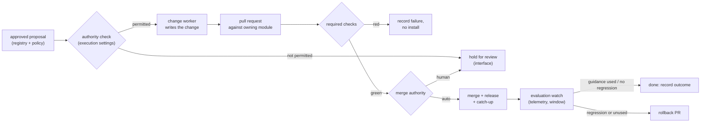

# Proposal: the executor — carrying an approved improvement through to installed, observed behavior

**Status:** Open — design for operator approval before any code (new subsystem).
**Authors:** Liz, agent-assisted
**Date:** 2026-11-09

## Problem

Under the six-module target (loom memory `decision-target-architecture-six-modules-2026-11-09`),
Tapestry owns coordination and execution: "carrying authorized changes through validation and
installation". Nothing executes today. Adoption requirement 4 (loom memory
`adoption-requirements-personal-loop-2026-10-21`) sets the bar: "A qualifying finding must trigger
diagnosis → creation or modification of the needed structure → validation → installation →
subsequent evaluation. Creating a candidate for Liz to manually advance does NOT complete the
workflow."

The only path that acts at all is the promotion bridge:

- an architecture-registry candidate is manually set to `promotion_requested`;
- `promote_dispatcher.py` sends a signed request to the Make_Skills engine;
- `skill_compiler` produces a skill.

Measured against requirement 4, it creates (for `kind=skill` only), and nothing else.

- It does not validate.
- It does not install. The compiled skill stays in the engine's database, never in a plugin any
  session loads.
- It does not evaluate or roll back.
- Eight of nine candidate kinds dead-end.
- Its creation step runs live from a retired repo.

## Insight

Most of an executor already exists. It is the change pipeline the fleet hardened on 2026-11-08.

| Requirement 4 step | Existing machinery |
|---|---|
| Creation or modification | a pull request against the module that owns the artifact |
| **Validation** | branch protection: 12 required checks (tests, plugin-version alignment, private-files guard, docs frontmatter, Vercel) gate every merge |
| **Installation** | merge, then the plugin version bump, then marketplace, then `catch-up-machine.ps1` |
| **Subsequent evaluation** | B1 telemetry: `artifact_ref` on every skill invocation, so `/telemetry/invocations` shows whether the new guidance actually ran |
| **Rollback** | revert the PR, then a version bump, then catch-up |

So the executor does not need its own validation sandbox or installer. It turns an approved
proposal into a pull request. The fleet's own gates validate it, and the fleet's own telemetry
evaluates it. The new pieces are the **proposal-to-PR step**, the **authority check**, and the
**post-install evaluation watch**.

## Decision: the executor is a gated proposal-to-PR runner with evaluation and rollback

### The flow



### Components

1. **Intake.** The architecture-registry `candidates` table (migration 007) plus a policy decision.
   That is already the platform-change gate, and it stays separate from QuickPrime's knowledge
   admission (loom memory `position-tapestry-on-five-component-moves-2026-11-09`). The executor
   acts only on candidates with an approving policy decision.
2. **Authority check.** Execution permissions come from the observatory's settings, which the
   target architecture says Tapestry enforces. They are expressed per (candidate kind, target
   module, risk). The safe **starting** default, until the interface exists, is that nothing
   auto-merges, and the executor runs every step up to a green PR.
   **That default does not satisfy requirement 4.** Requirement 4 says a candidate the operator
   must advance by hand does not complete the workflow, and the master plan says "no extra user
   prompt advances routine authorized work" (`master-plan-personal-loop.md:18`). Under the
   start default, every install waits for a click, so **M2 cannot pass**. Requirement 4 is met
   only when the operator has **pre-authorized** at least one (kind, target, risk) in advance.
   For example: new `kind=skill` additions to tapestry-patterns with green required checks and
   the evaluation watch armed. Within that authority the executor merges and installs without
   prompting. Anything outside it becomes an explicit exception for her review.
   (Correction 2026-11-10, raised by a drift check. The earlier text claimed requirement 4 was
   "met up to the merge approval", which reversed the requirement.)
3. **Change worker.** A pluggable slot that writes the change: a skill, hook, agent or config
   edit. It always produces a PR with a changelog entry, and never pushes to `main`. This is
   the one piece that needs a model.
4. **Validation.** The target repo's own required checks. If the target repo has no branch
   protection, the executor refuses to auto-merge there. Validation it does not trust does not
   count.
5. **Installation.** Merge, then the release or version bump the owning module defines, then
   distribution (marketplace refresh). Per-machine catch-up stays as it is today.
6. **Evaluation watch.** For a fixed window after install, read `/telemetry/invocations` for
   the new artifact's ref. Expect it to be loaded and used, with no rise in the relevant
   friction signal. The window length is per kind.
7. **Rollback.** A revert PR through the same gates. It is triggered by the evaluation watch or
   by the interface.

### Adopt
- The bridge's HMAC wire contract and idempotency (`skill-making/hmac_verify.py`, `models.py`)
  for any engine-facing call that survives.
- `skill_compiler` as one change-worker implementation for `kind=skill`, once its deploy shape
  is settled (skill-making README, "Deploy shape TBD").

### Reject
- A separate validation sandbox. The required checks are the validation.
- An installer that writes into plugin caches. Installation goes through releases, so every
  machine converges the same way.
- Direct pushes to `main` from any worker.

## Code sketch

```python
# services/executor/run.py — one pass, cron-driven like self-observer
for cand in registry.approved_unexecuted():
    auth = authority.for_(cand.kind, cand.target_module, cand.risk)
    if not auth.may_open_pr:
        registry.mark(cand, "held:authority"); continue
    pr = worker.propose_change(cand)          # PR + changelog, never main
    result = checks.wait(pr)                   # the target repo's required checks
    if result.red:
        registry.mark(cand, "failed:validation", evidence=result); continue
    if auth.may_merge and repo.is_protected(cand.target_module):
        install.merge_and_release(pr)
        watch.schedule(cand, artifact_ref=pr.artifact_ref, window=auth.eval_window)
    else:
        registry.mark(cand, "held:merge-approval", pr=pr.url)
```

## Implementation phases

| Phase | Scope | Output | Blocks |
|---|---|---|---|
| **E0: design approval** | this proposal | operator answers on the open questions | everything |
| **E1: intake + authority** | read approved candidates; authority table (default: nothing auto-merges); `held:*` statuses | the executor knows what it may do | E2 |
| **E2: change worker (kind=skill)** | one worker; PR + changelog against tapestry-patterns | a green PR from an approved candidate, no human authoring | E3 |
| **E3: install + evaluation watch** | merge within pre-authorized authority (no per-change click); release; telemetry watch | **M2 acceptance:** the tutoring correction becomes an installed skill, and a later session shows the guidance **loaded and followed**. Telemetry showing it was invoked proves loading. Following needs the step-7 behavioral check (plan :16; procedure: "skill creation alone does not establish behavioral success") | E4 |
| **E4: rollback + more kinds** | revert path; hook and agent workers | the full requirement-4 loop for more than skills | — |

E2 depends on B1 being live, because the evaluation watch reads `artifact_ref`. E3 is the M2
milestone.

## Two-mode notes

| Mode | What changes |
|---|---|
| **Self-host** | One operator; the authority table is that operator's; PRs land in the operator's own repos. |
| **Hosted-multitenant** | The authority table is per tenant. A worker only ever opens PRs against repos the tenant owns. A tenant's execution settings never reach another tenant's repos. Sharing an implementation never shares data. |

## Open questions

1. **(Operator) Authority: what will you pre-authorize so that M2 can pass?** M2 must install a
   change "without another user prompt", so at least one (kind, target, risk) has to be authorized
   in advance. The recommended scope is a single narrow grant: new `kind=skill` additions to
   tapestry-patterns, with green required checks, rollback armed, and the evaluation watch on.
   Everything else stays approval-required. Without such a grant, the executor can only ever
   reach a green PR, and M2 fails by design.
2. **(Research, Tapestry's) Which change worker runs first.** The candidates are:
   - your GitHub Copilot subscription's coding agent, assigned through an issue (no new
     billing, if your plan includes it);
   - a scheduled Claude Code session on an operator machine;
   - `skill_compiler` with its own model key (not provisioned).

   Tapestry will verify Copilot coding-agent availability on your plan, then recommend.
3. **(Research, Tapestry's) Where the executor runs.** A Render cron like the self-observer, or a
   GitHub Actions workflow triggered on approval. It is decided by the worker choice in question 2.

## What this implies for the next action

Approve or redirect the flow above and answer question 1. Then E1 (intake and authority) can
start. It needs no model and no new billing.

## Sources

- loom memory `adoption-requirements-personal-loop-2026-10-21` (requirement 4; M2 acceptance
  scenario: the tutoring correction)
- loom memory `decision-target-architecture-six-modules-2026-11-09`
- surveyor `docs/decomposition/2026-11-09-implementation-map.md` §6, §8
- `services/architecture-registry/promote_dispatcher.py:1-30`; `services/skill-making/README.md`
- `docs/audits/2026-11-08-check-layers-audit.md` (the required checks that become validation)
- `docs/changelog/2026-11-09-b1-skill-attribution.md` (the telemetry that becomes evaluation)
- ADR-0001 observer topology (candidates carry a recommended automation level; activation is
  policy-gated)
